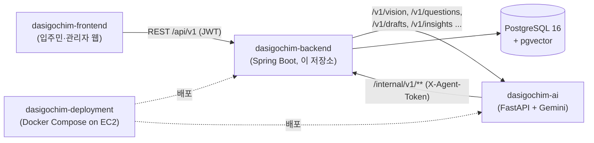

# 다시고침 백엔드 (dasigochim-backend)

**다시고침**은 서울 청년안심주택 입주민을 위한 민원 서비스예요.
입주민이 사진을 찍으면 AI 챗봇이 확인 질문을 몇 가지 던지고 신고서 초안을 써 주고, 입주민은 세대나 공용공간의 3D 평면도 위에 핀을 꽂아 위치를 남깁니다.
관리자(전체 관리자 / 지역 담당자 / 단지 관리인)는 맡은 구역 안에서 대시보드, 지도, 위험도 색으로 칠해진 3D 핀, 신고 관리 화면을 씁니다.

이 저장소는 그 서비스의 **Spring Boot API 서버**예요. 신고·단지·관리자·알림 데이터를 PostgreSQL에 저장하고, 프론트엔드에 REST API를 제공하고, AI 서버(FastAPI + Gemini)를 호출하거나 AI 서버의 호출을 받습니다.

- 배포된 프론트엔드: https://dasigochim-frontend.vercel.app

## 시스템 구성



## 주요 도메인과 기능

| 도메인 | 하는 일 |
|---|---|
| 신고(`report`, `photo`) | 임시 신고 생성 → 사진 업로드 → 위치(공간·3D 핀) 지정 → 제출. 상태는 `RECEIVING → RECEIVED → REVIEWING → RESOLVED` |
| AI 신고 플로우(`ai`) | 확인 질문을 하나씩 받고 신고서 초안·위험도·담당 부서를 만듭니다. `AI_MODE=mock`(기본) 또는 `http` |
| 청년주택(`building`) | 지역(시·도/시·군·구), 단지, 세대(호수 → 세대 타입·3D 장면), 공용공간 |
| 관리자(`admin`, `admin_report`) | 역할별 담당 구역(`admin_scopes`) 안에서 통계·신고 목록·상태 변경·부서 재배정·위험도 조정·처리 완료·3D 공간 지도 |
| 인사이트(`insight`) | 제출이 커밋된 뒤 비동기로 담당자용 요약·인사이트 생성 |
| 알림(`notification`) | 고위험 신고, 상태 변경, 처리 완료 알림 (입주민·관리자) |
| 내부 API(`internal`) | AI 서버가 부르는 부서 업무범위 검색 / 부서 코드 검증 / 과거사례 검색 |
| 인증(`auth`) | Google ID token 로그인, 관리자 ID/비밀번호 로그인, (선택) 게스트 로그인, JWT 발급·갱신 |

## 빠른 시작

### Docker Compose로 백엔드 + PostgreSQL 실행

```bash
cp .env.example .env
# .env 의 POSTGRES_PASSWORD, JWT_SECRET(openssl rand -base64 64) 을 로컬 값으로 바꿔 주세요
docker compose up -d --build
docker compose ps
```

- API: `http://localhost:8080/api/v1`
- Swagger UI: `http://localhost:8080/swagger-ui.html`
- Health: `http://localhost:8080/actuator/health`

`local` 프로필에서는 시작할 때 로컬 관리자 계정(`admin` / `admin1234`)이 만들어져요. 운영 프로필에서는 만들어지지 않습니다.

```bash
docker compose logs -f backend   # 로그
docker compose down              # 종료 (DB·업로드 볼륨은 유지)
docker compose down -v           # 볼륨까지 삭제 — 로컬 데이터가 사라지니 초기화할 때만!
```

### Gradle로 직접 실행 (Java 21)

```bash
docker compose up -d postgres
./gradlew bootRun
```

Gradle로 직접 띄우면 업로드 파일은 `build/uploads`에, Docker로 띄우면 `/app/uploads` named volume에 저장돼요.

### AI 서버와 연결

기본값 `AI_MODE=mock`이면 목 응답을 씁니다. 실제 AI 서버([dasigochim-ai](https://github.com/anniversary-site/dasigochim-ai))를 먼저 8000 포트로 띄운 뒤:

```bash
AI_MODE=http docker compose up -d --build backend
```

`AI_MODE`를 바꾼 뒤에는 꼭 `up -d`로 컨테이너를 **재생성**하세요. `docker compose restart`는 환경변수를 다시 읽지 않아요. 호출 흐름은 [architecture.md](readme/architecture.md#ai-연동)에 정리해 두었습니다.

### 주요 환경변수

| 변수 | 설명 | 기본값 |
|---|---|---|
| `POSTGRES_DB` / `POSTGRES_USER` / `POSTGRES_PASSWORD` | DB 이름·사용자·비밀번호 | `dasigochim` |
| `BACKEND_PORT` / `POSTGRES_PORT` | 호스트에 공개할 포트 | `8080` / `5432` |
| `JWT_SECRET` | JWT HMAC Base64 키 | **필수** |
| `GOOGLE_CLIENT_ID` | Google ID token audience 검증용 Web Client ID (프론트 `VITE_GOOGLE_CLIENT_ID`와 같은 값) | 없음 |
| `CORS_ALLOWED_ORIGINS` | 허용할 프론트 Origin (쉼표 구분) | `http://localhost:5175` |
| `AI_MODE` | `mock` 또는 `http` | `mock` |
| `AI_SERVER_BASE_URL` | AI 서버 주소 | Compose: `http://host.docker.internal:8000` |
| `AGENT_TOKEN` | AI 서버가 `/internal/**`을 부를 때 쓰는 토큰. AI 서버 `.env`와 같은 값 | 개발용 기본값 |
| `GUEST_LOGIN_ENABLED` / `GUEST_ACCESS_CODE` | 심사용 게스트 로그인. 꺼져 있으면 `/api/v1/auth/guest` 자체가 등록되지 않아요 | `false` |

전체 목록은 `src/main/resources/application.yml`과 `.env.example`을 참고하세요. `.env`는 Git에서 제외되어 있으니, 실제 비밀번호나 키를 `.env.example`·Compose 파일에 적어 커밋하면 안 됩니다.

## 테스트

```bash
./gradlew test    # 테스트 (H2 인메모리 DB, PostgreSQL 호환 모드)
./gradlew build   # 빌드 + 테스트
```

## 폴더 구조

```
src/main/java/com/dasigochim
├── activitylog     신고 처리 이력(report_activity_logs)
├── admin           관리자·역할·담당 구역, AdminAccessService
├── admin_report    관리자 API: 통계, 신고 관리, 3D 공간 지도
├── ai              AI 신고 플로우 API와 AI 서버 클라이언트(mock/http)
├── auth            Google·관리자·게스트 로그인
├── building        지역, 청년주택 단지, 세대, 공용공간
├── common          보안(JWT, Agent 토큰), 설정, 예외, 공통 응답
├── department      담당 부서와 업무범위 문장
├── file            HWP 신고서 생성, 로컬 파일 저장
├── insight         담당자용 인사이트(비동기 생성)
├── internal        AI 서버 전용 내부 API
├── notification    알림
├── photo           신고 사진
├── report          신고 도메인과 입주민 API
└── user            입주민 프로필·내 신고·내 알림
src/main/resources
├── db/migration    Flyway 마이그레이션 V1~V20
└── templates       HWP 신고서 양식
scripts/dummy-reports  로컬·시연용 더미 민원 SQL
```

## 문서

- [기술 스택](readme/tech-stack.md) — 라이브러리 버전과 쓰임새, Docker 이미지, CI
- [아키텍처](readme/architecture.md) — 도메인 지도, 엔티티, 신고 생명주기, 권한, AI 연동
- [API 목록](readme/api.md) — 컨트롤러별 엔드포인트와 인증
- [데이터베이스](readme/database.md) — Flyway 마이그레이션, 더미 데이터 스크립트

## 관련 저장소

- [dasigochim-frontend](https://github.com/anniversary-site/dasigochim-frontend) — 입주민·관리자 웹
- [dasigochim-backend](https://github.com/anniversary-site/dasigochim-backend) — API 서버 (이 저장소)
- [dasigochim-ai](https://github.com/anniversary-site/dasigochim-ai) — AI 서버 (FastAPI + Gemini)
- [dasigochim-deployment](https://github.com/anniversary-site/dasigochim-deployment) — Docker Compose 배포 (EC2)
