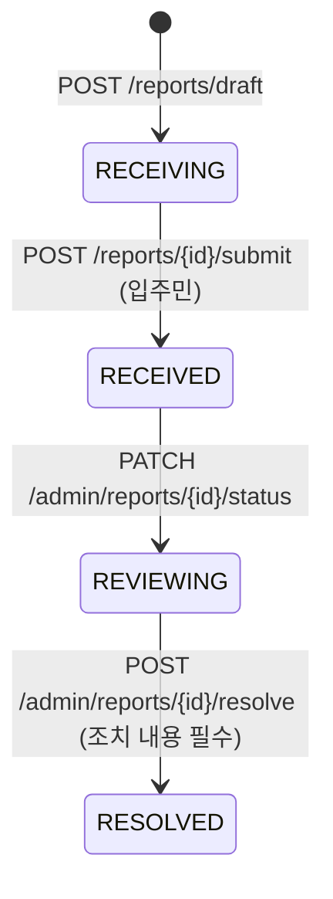

# 아키텍처

백엔드가 어떤 도메인으로 나뉘어 있고, 신고 한 건이 어떻게 흘러가며, 관리자 권한과 AI 연동이 어떻게 동작하는지 정리했어요. 모든 경로는 `src/main/java/com/dasigochim` 기준입니다.

[← README로 돌아가기](../README.md)

## 패키지(도메인) 지도

| 패키지 | 주요 클래스 | 역할 |
|---|---|---|
| `report` | `Report`, `ReportService`, `ReportViewService`, `ReportController` | 신고 엔티티, 임시 신고~제출, 피드, 추적번호 조회, 중복 후보 |
| `photo` | `ReportPhoto`, `PhotoService` | 신고 사진 업로드(신고당 최대 5장) |
| `building` | `Building`, `BuildingUnit`, `BuildingSpace`, `Region`, `BuildingService` | 지역·단지·세대·공용공간 조회 |
| `ai` | `AiController`, `AiAnalysisService`, `client/*` | AI 신고 플로우 API, AI 서버 클라이언트(mock/http) |
| `internal` | `InternalAiController`, `DutySearchService`, `DepartmentResolveService`, `CaseSearchService` | AI 서버가 부르는 내부 API |
| `insight` | `ReportInsight`, `ReportInsightService`, `ReportSubmittedInsightListener` | 담당자용 인사이트 비동기 생성 |
| `admin` | `Admin`, `AdminRole`, `AdminScope`, `AdminAccessService` | 관리자 계정, 역할, 담당 구역, 권한 검사 |
| `admin_report` | `AdminReportController`, `AdminReportService`, `AdminSpaceMapService` | 관리자 통계·신고 관리·3D 공간 지도 |
| `department` | `Department`, `DepartmentDuty` | 담당 부서와 부서 업무범위 문장(AI 부서 분류 코퍼스) |
| `notification` | `Notification`, `HighRiskNotificationService`, `AdminNotificationService` | 입주민·관리자 알림 |
| `activitylog` | `ReportActivityLog` | 상태 변경·부서 재배정·처리 완료 이력 |
| `user` | `User`, `MeService`, `MeController` | 입주민 프로필(거주 단지·동·호), 내 신고, 내 알림 |
| `auth` | `AuthService`, `GoogleSocialOAuthClient`, `GuestAuthService` | 로그인과 토큰 |
| `file` | `TemplateHwpReportGenerator`, `LocalFileStorageService` | HWP 신고서 생성, 파일 저장 |
| `common` | `SecurityConfig`, `JwtTokenProvider`, `AgentTokenFilter`, `ApiResponse`, `GlobalExceptionHandler` | 보안, 설정, 공통 응답·예외 |

> 관리자 화면의 챗봇은 이 저장소에 API가 없어요. 이 백엔드의 AI 관련 엔드포인트는 입주민 신고 플로우(`/api/v1/ai/**`)와 AI 서버 전용 내부 API(`/internal/v1/**`)뿐입니다.

## 주요 엔티티와 테이블

| 엔티티 | 테이블 | 설명 |
|---|---|---|
| `Report` | `reports` | 신고. 상태, 위험도(+출처·근거), 부서, 신고자, 단지, 공간(`space_type`/`space_code`/`space_name`), 동·세대 타입, 3D 핀(`scene_id`, `pin_x/y/z`, `pin_label`), HWP 파일 URL, 원 신고(`parent_report_id`), 제출·처리 완료 시각 |
| `ReportPhoto` | `report_photos` | 신고 사진 |
| `ReportActivityLog` | `report_activity_logs` | 처리 이력 (`STATUS_CHANGE`, `DEPARTMENT_REASSIGN`, `RESOLVE`) |
| `ReportInsight` | `report_insights` | 신고 1건당 1행. 요약·키워드·반복 여부·인사이트·권고 우선순위(`IMMEDIATE/HIGH/NORMAL/LOW`) |
| `Building` | `buildings` | 청년주택 단지 (시·도, 시·군·구, 공급 단계 등) |
| `BuildingUnit` | `building_units` | 호수 → 세대 타입·3D 장면 표 |
| `BuildingSpace` | `building_spaces` | 공용공간(지하 주차장, 로비, 피트니스 …)과 3D 장면 |
| `Region` | `regions` | 전국 시·도 / 시·군·구 |
| `User` | `users` | 입주민 (Google 계정, 연락처, 거주 단지·동·호) |
| `Admin` | `admins` | 관리자 (역할 `role`, 소속 부서) |
| `AdminScope` | `admin_scopes` | 관리자 담당 구역 (시·도(+시·군·구) 또는 단지 하나) |
| `Department` | `departments` | 담당 부서 (코드, 연락처, 활성 여부) |
| `DepartmentDuty` | `department_duties` | 부서 업무범위 문장 |
| `Notification` | `notifications` | 알림 (수신자는 입주민 또는 관리자 중 하나) |

엔티티가 없는 테이블로 `department_duty_corpus`(업무범위 코퍼스 버전)와 `report_embeddings`(pgvector, 현재 미사용)가 있어요. 부서 코드는 `FACILITY`, `SAFETY_CENTER`, `GENERAL_AFFAIRS`, `ELEVATOR`, `ELECTRIC`, `FIRE_GAS`, `SANITATION` 7개입니다(V2, V19).

## 신고 생명주기

- **RECEIVING (작성 중)**: 사진·위치·내용을 채우는 임시 상태예요. 이 상태에서만 수정·AI 분석·삭제가 됩니다(`Report.ensureDraft`). 관리자 목록과 피드에는 나오지 않아요.
- **RECEIVED (접수)**: 제출하면 추적번호 `DG-<연도>-<6자리 id>`가 붙고, 이력·"접수" 알림이 남고, 고위험이면 고위험 알림을 보내고, 커밋 후 인사이트 생성 이벤트(`ReportSubmittedEvent`)가 발행돼요.
- **REVIEWING (검토 중)**: 관리자의 상태 변경 API는 `REVIEWING`만 받아요.
- **RESOLVED (처리 완료)**: 완료는 resolve API로만 가능하고, `resolved_at`이 기록되며 입주민에게 완료 알림이 갑니다.

허용되지 않은 전이는 `INVALID_STATUS_TRANSITION` 오류가 납니다(`Report.transitionTo`).

### 다른 입주민에게 보이는 범위

- 피드 `GET /api/v1/reports/feed?filter=mine|others`: `others`는 같은 단지의 다른 입주민 신고예요.
- 추적번호 조회는 본인 또는 같은 단지 입주민만 할 수 있어요.
- 세대 내부(`space_type = UNIT`) 신고는 다른 입주민에게 동·호수·층과 자유 서술 위치를 가리고 세대 타입·공간 이름 정도만 보여 줍니다(`ReportViewService.toPublicResponse`).

## 위험도

| 항목 | 값 |
|---|---|
| 등급 (`RiskLevel`) | `HIGH`, `MEDIUM`, `LOW` |
| 출처 (`RiskLevelSource`) | `AI` (AI 분석이 매김), `ADMIN` (관리자가 조정) |

- AI 서버는 4단계(`low/medium/high/critical`)를 주고, 백엔드는 `critical`을 `HIGH`로 접어요(`HttpAiAnalysisClient.toRiskLevel`).
- AI가 준 판단 근거는 `risk_level_rationale`, 재산출로 바뀌었는지는 `risk_level_changed`에 저장해요. 관리자가 등급을 조정하면 출처가 `ADMIN`이 되고 근거는 지워집니다.
- `HIGH`로 제출되거나 관리자가 `HIGH`로 올리면 신고자와 **해당 단지를 담당 구역에 포함하는 관리자**에게 고위험 알림이 갑니다(`HighRiskNotificationService`).

## 관리자 담당 구역과 권한

| 역할 (`AdminRole`) | 화면 이름 | 범위 |
|---|---|---|
| `SUPER` | 전체 관리자 | 전국, 제한 없음 |
| `REGION` | 지역 담당자 | `admin_scopes`의 시·도(+시·군·구) |
| `BUILDING` | 단지 관리인 | `admin_scopes`의 특정 단지 |

`AdminAccessService`가 모든 관리자 API의 관문이에요.

- `access(adminId)`: `SUPER`면 전체, 아니면 담당 구역에 포함되는 단지 id 집합을 계산합니다. 한 관리자가 여러 구역을 맡을 수 있어요.
- `assertReport` / `assertBuilding`: 범위 밖 신고·단지 요청은 **서버에서 403**(`ACCESS_DENIED`)으로 막아요. 화면에서 숨기는 것만으로는 부족하다는 원칙입니다.
- 통계·목록·부서별 대기 건수는 같은 범위를 JPA `Specification`(`AdminReportService.inScope`)으로 걸러서 계산해요.

### 인증 구조

`SecurityConfig`에는 필터 체인이 두 개 있어요.

1. `/internal/**` (순서 1): JWT 대신 `X-Agent-Token` 헤더를 상수 시간 비교로 검증합니다(`AgentTokenFilter`). CORS는 열지 않아요.
2. 나머지 (순서 2): JWT. 역할은 `USER`(입주민)와 `ADMIN`(관리자)으로 나뉘고, 관리자 토큰의 id는 `admins.id`라서 입주민 전용 API(`/api/v1/me/**`, `/api/v1/ai/**`, 신고 쓰기)에는 통과시키지 않아요. 경로별 규칙은 [api.md](api.md)를 보세요.

## AI 연동

### 모드

| `AI_MODE` (`app.external.ai`) | 구현 | 동작 |
|---|---|---|
| `mock` (기본) | `MockAiAnalysisClient` | 고정된 목 응답 |
| `http` | `HttpAiAnalysisClient` → `AiServerClient` | AI 서버(`AI_SERVER_BASE_URL`)를 실제로 호출. 읽기 타임아웃 기본 180초 |

### 백엔드 → AI 서버 호출 흐름

| 백엔드 API | AI 서버 호출 | 비고 |
|---|---|---|
| `POST /api/v1/ai/report-flow/next-question` (첫 질문) | ① `/v1/vision/analyze` → ② `/v1/questions/next` | |
| `POST /api/v1/ai/report-flow/next-question` (이후 질문) | ② `/v1/questions/next` | ①은 캐시 재사용 |
| `POST /api/v1/ai/report-flow/draft` | ④ `/v1/drafts/generate` → ③ `/v1/departments/classify` | 초안·위험도·근거·부서 |
| `POST /api/v1/reports/{id}/submit` | ⑤ `/v1/insights/generate` | 커밋 후 **비동기** |

- 확인 질문은 한 번에 하나씩 만들어요. 클라이언트가 지금까지의 질문·답변을 `answers`로 보내면 그 이력을 넘겨 아직 확인되지 않은 것을 묻고, 응답의 `last`가 `true`면 초안을 만들 차례예요. 질문 수 설정은 `app.external.ai-server.question-count: 3`입니다.
- 사진은 신고의 첫 장을 base64로 보내요. 사진이 없으면 판독할 수 없어 502로 실패합니다.
- ①의 판독 결과는 `AiVisionCache`에 `report-{id}` 키로 30분간 메모리 캐시해요.
- 부서는 AI 서버가 준 코드를 `departments.code`로 찾아요. 양쪽 코드 집합이 같아야 합니다.
- `POST /api/v1/ai/analyze-content`, `POST /api/v1/ai/draft-from-text`는 사진 없는 텍스트 전용 계약이라 AI 서버에 대응 경로가 없어서 `http` 모드에서도 목 응답을 돌려줘요.

### 담당자 인사이트

⑤ 인사이트는 `@TransactionalEventListener` + `@Async("insightExecutor")`(코어 1, 최대 2, 큐 20, 넘치면 CallerRuns)로 제출 커밋 뒤에 만들어 `report_insights`에 저장해요. 실패해도 접수에는 영향이 없고 로그만 남기며, 관리자가 `POST /api/v1/admin/reports/{id}/insight`로 다시 만들 수 있어요. 위험도 근거와 인사이트는 담당자 내부용이라 입주민 응답에는 넣지 않고 관리자 경로로만 노출합니다.

### AI 서버 → 백엔드 내부 API

AI 서버가 `X-Agent-Token`(`AGENT_TOKEN`, AI 서버 `.env`와 같은 값)을 붙여 호출해요. 응답은 `ApiResponse`로 감싸지 않고 본문을 그대로 돌려줍니다 — AI 서버가 그대로 파싱하기 때문이에요.

| 계약 | 엔드포인트 | 동작 |
|---|---|---|
| C-1 | `POST /internal/v1/rag/duty-search` | `department_duties` 문장을 문자 bigram 자카드 유사도로 채점해 상위 후보 반환(AI 서버 stub과 같은 점수 함수). 실패하면 부서 분류 전체가 실패 |
| C-2 | `POST /internal/v1/departments/resolve` | LLM이 고른 부서 코드를 검증. 코드가 없거나 비활성이거나 신뢰도가 임계값(`AI_DEPARTMENT_CONFIDENCE_THRESHOLD`, 기본 0.7) 미만이면 기본 부서(`AI_DEFAULT_DEPARTMENT_CODE`, 기본 `SAFETY_CENTER`)로 강등 |
| C-5 | `POST /internal/v1/cases/search` | 과거 신고를 "같은 단지 먼저 → 최근순"으로 찾고 처리 조치와 집계를 함께 반환. 유사도 점수는 아직 `null`(pgvector는 2단계 예정). 실패해도 ④⑤는 참고 없이 진행 |

## 파일

- 업로드 파일과 생성된 HWP는 `LocalFileStorageService`가 `app.file.upload-dir`에 저장하고, `/files/**`로 정적 제공해요(`WebConfig`, 인증 없이 접근 가능).
- HWP 신고서는 `TemplateHwpReportGenerator`가 `templates/dasigochim-report-template.hwp`의 토큰을 신고 내용으로 바꾸고 사진을 넣어 만들어요. `mock-hwp` 프로필에서는 가짜 URL만 돌려주는 `MockHwpReportGenerator`를 씁니다.
